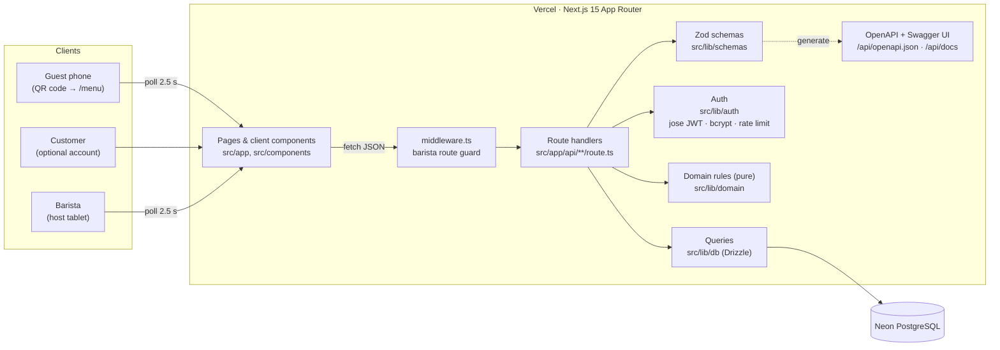
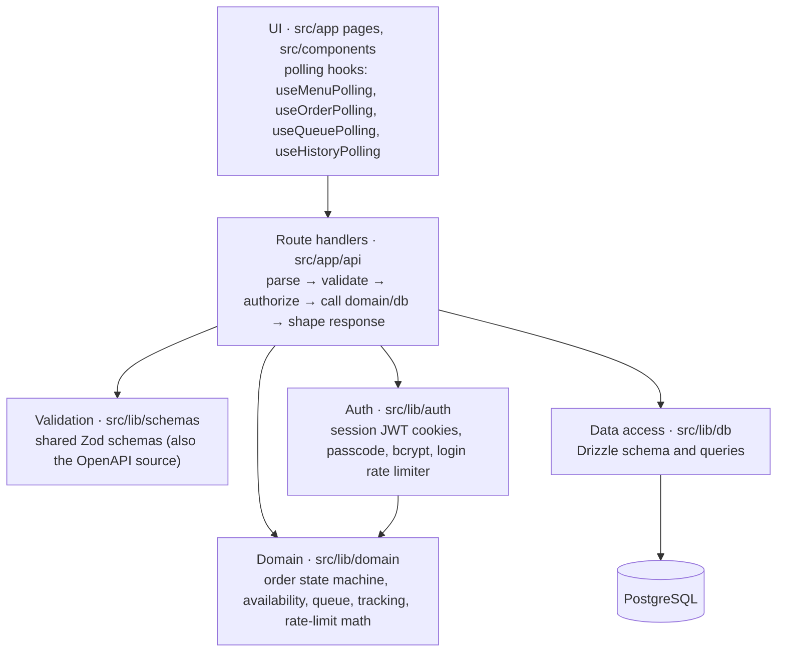
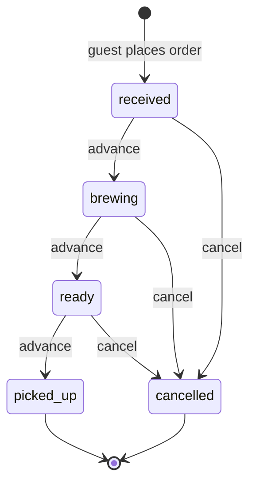
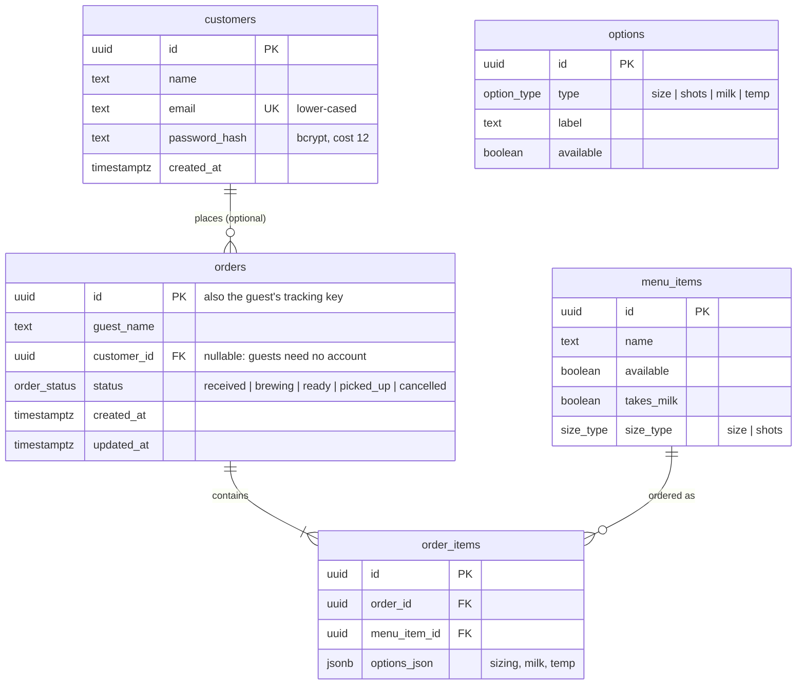
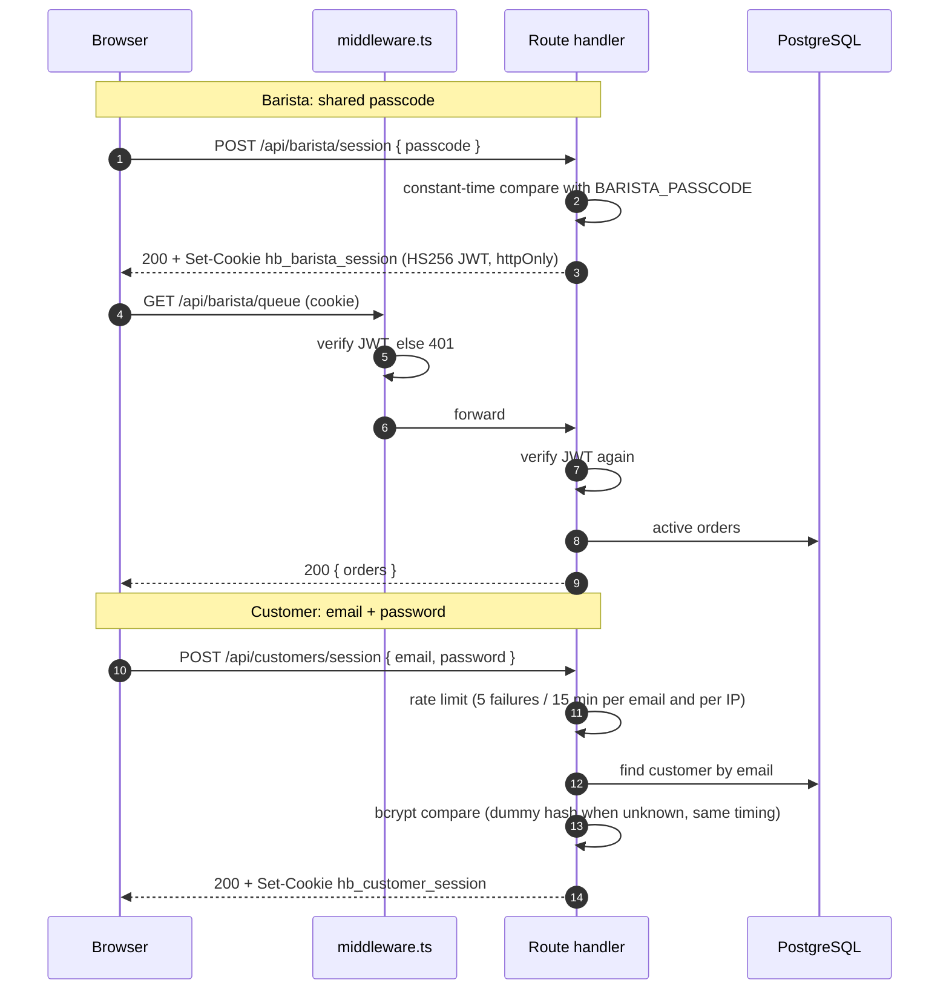
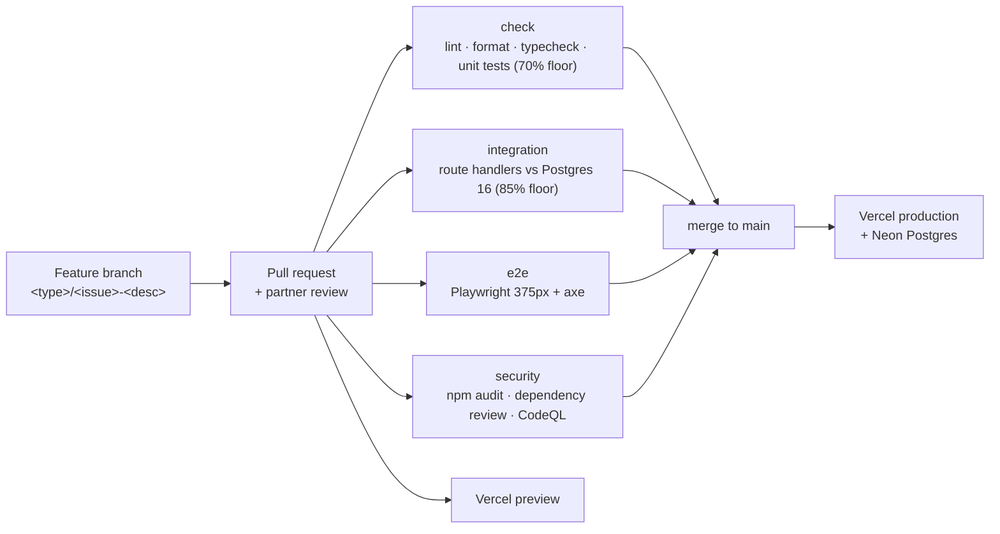

# Architecture

Homebarista is a single Next.js 15 app: the same deployment serves the React pages and the JSON API. There is no separate backend service, no WebSocket server, and no paid third-party API. Live updates come from polling every 2.5 seconds.

## System overview

## Layering

Dependencies only point down. Business rules never import the database, and the UI never talks to the database directly.

| Layer          | Rule                                                                                                                               |
| -------------- | ---------------------------------------------------------------------------------------------------------------------------------- |
| UI             | Calls the API with `fetch`; holds view state only.                                                                                 |
| Route handlers | Every body and path parameter goes through a shared Zod schema. Errors are `{ error }` or `{ errors[] }` with 401/404/409/422/500. |
| Domain         | Pure functions, no I/O. Covered by unit tests (goal: 95%).                                                                         |
| Data access    | The only code that imports Drizzle.                                                                                                |

## Order status state machine

Defined once in [`src/lib/domain/orderStatus.ts`](../src/lib/domain/orderStatus.ts) and enforced by `PATCH /api/orders/{id}/status`.

The update is conditional (`UPDATE … WHERE id = $1 AND status = $from`), so if two baristas tap at once, only one wins and the other gets `409 Order status changed`.

## Database schema

Source of truth: [`src/lib/db/schema.ts`](../src/lib/db/schema.ts). Applied with drizzle-kit.

Notes:

- `options` has no foreign key: the chosen labels are copied into `order_items.options_json`, so history stays readable if an option is later renamed or turned off.
- Each order currently has exactly one `order_items` row (one drink per order, PRD §7).
- There is no `prices` or `payments` table by design (PRD §4 Non-goals).

## Authentication

- Both cookies are `httpOnly`, `SameSite=Lax`, and `Secure` in production, signed with `JWT_SECRET` (≥ 32 chars).
- Guests have no session: `GET /api/orders/{id}` is public because the random UUID is the access key.
- `POST /api/orders` takes the customer only from the cookie, never from the body.

## Real-time updates

| Screen             | Hook                | Endpoint                   |
| ------------------ | ------------------- | -------------------------- |
| Guest menu         | `useMenuPolling`    | `GET /api/menu`            |
| Guest order status | `useOrderPolling`   | `GET /api/orders/{id}`     |
| Barista queue      | `useQueuePolling`   | `GET /api/barista/queue`   |
| Barista history    | `useHistoryPolling` | `GET /api/barista/history` |

Each hook polls every 2.5 s, and responses are sent with `Cache-Control: no-store`. At a home party's scale this is cheaper and simpler than WebSockets (PRD §9).

## Delivery pipeline

